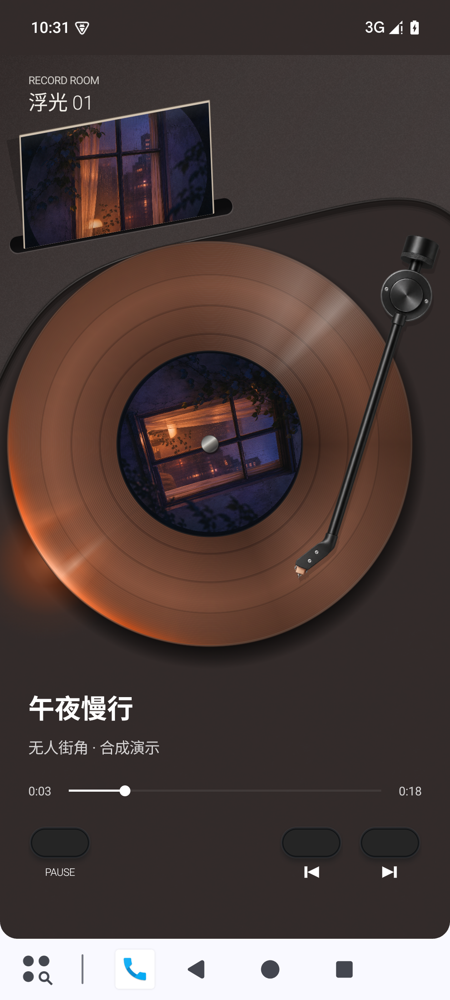
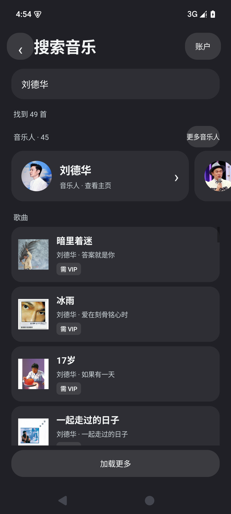
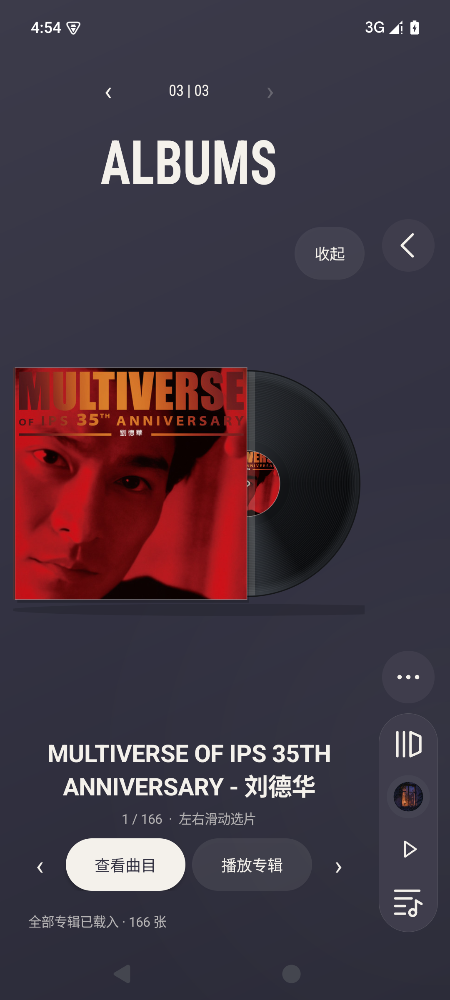
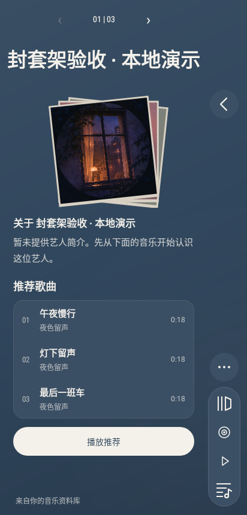
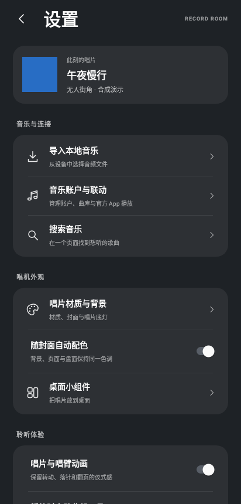
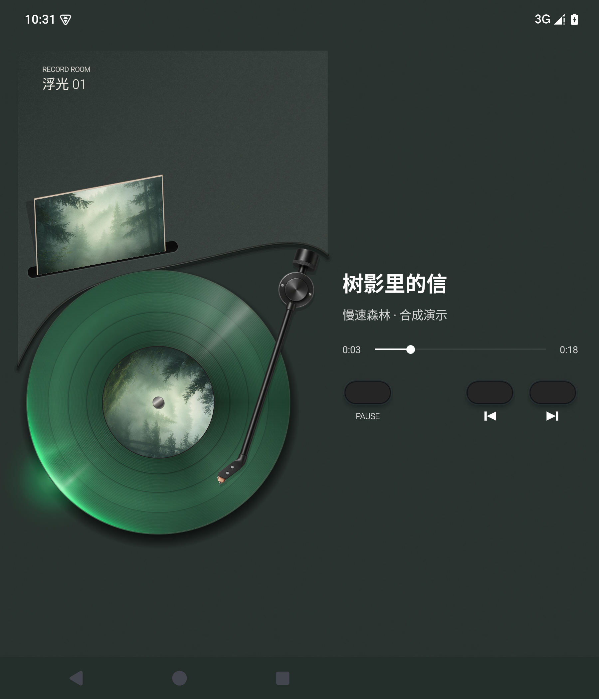

<div align="center">

# Record Room · 唱片机

把喜欢的音乐，放回唱片上。

Android 原生黑胶播放器 · 封面配色 · 竖立专辑架 · 音乐人主页

**0.7.8 预览版** · Android 8.0+ · ARM / ARM64

[**下载 Android 安装包**](https://github.com/liudbhx7-bot/record-room-android/releases/download/v0.7.8/Record-Room-0.7.8-Android.apk) · [版本说明](https://github.com/liudbhx7-bot/record-room-android/releases/tag/v0.7.8) · [使用指南](docs/USER_GUIDE.md) · [常见问题](docs/FAQ.md)

</div>

Record Room 是一款围绕唱片、唱针和完整专辑设计的 Android 音乐播放器。导入自己的音频，搜索歌曲与音乐人，翻开一张专辑，或者连接正在播放的官方音乐 App，让音乐以唱片的方式呈现。

0.7.8 将「浮光 01」作为默认唱机，直接随应用升级提供，无需购买。当前专辑的封套插在机身后方，盘心呈现同一张封面，左下盘缘透出随封面变化的光。盘面、底灯、背景和页面随当前封面配色；立体封套可以滑动选片、打开并抽出唱片。搜索与设置采用柔和的平面分组，半透明控件集中在播放器的悬浮操作区。

> **当前状态：公开预览版。** QQ 私人账号的 VIP 全曲播放尚未确认修复；Apple Music 需要自行配置开发者令牌；OPPO Find N6 / ColorOS 真机及长时间后台表现仍待验证。完整范围见[验证记录](docs/VERIFICATION.md)。

## 立即下载

| 内容 | 入口 |
| --- | --- |
| Android 安装包 | [Record-Room-0.7.8-Android.apk](https://github.com/liudbhx7-bot/record-room-android/releases/download/v0.7.8/Record-Room-0.7.8-Android.apk) |
| 版本说明与校验文件 | [v0.7.8 Release](https://github.com/liudbhx7-bot/record-room-android/releases/tag/v0.7.8) |
| 公开源码 | [浏览源码](https://github.com/liudbhx7-bot/record-room-android) · [版本归档](https://github.com/liudbhx7-bot/record-room-android/releases/tag/v0.7.8) |
| 问题反馈 | [提交问题](https://github.com/liudbhx7-bot/record-room-android/issues/new/choose) |

下载 `.apk` 文件即可安装，GitHub 自动生成的 `Source code` 压缩包是开发源码。最低系统为 Android 8.0（API 26），当前目标 API 36，包名为 `com.recordroom.vinyl`，版本号为 `0.7.8`，版本代码为 `19`。

相同签名的旧版本可覆盖安装。自行编译的安装包使用自己的签名，通常不能直接覆盖本项目发布的 APK，详见[安装与更新](docs/USER_GUIDE.md#安装与更新)。当前没有应用内自动更新功能，请从 Release 下载更新。

## 界面预览

左图为 **0.7.8 浮光 01** 在 Android 模拟器上的播放页，使用内置演示音频。中图与右图为 0.7.7 的公开曲库搜索与专辑展示。

<table>
  <tr>
    <th>唱片与唱针</th>
    <th>统一搜索</th>
    <th>打开一张专辑</th>
  </tr>
  <tr>
    <td></td>
    <td></td>
    <td></td>
  </tr>
</table>

下列音乐人和设置页取自 **0.7.7 原生界面的固定演示数据**。

<table>
  <tr><th>音乐人介绍</th><th>随封面变化的设置</th></tr>
  <tr>
    <td align="center"></td>
    <td align="center"></td>
  </tr>
</table>

<details>
<summary>查看较宽显示尺寸下的播放器</summary>



此图为 0.7.8 APK 在 Android 模拟器较宽显示尺寸下的播放页。

</details>

## 核心功能

| 功能 | 可以做什么 |
| --- | --- |
| 黑胶唱机 | 唱片旋转、唱臂落针、拖针定位，以及播放、上一首、下一首控制。保留现有唱针与三个实体按钮。 |
| 封面配色 | 根据当前封面调整盘面、背景、底灯及页面色调；可切换材质、灯光和手动外观。 |
| 专辑资料库 | 同专辑曲目归为一张专辑，支持网格和立体唱片架浏览。 |
| 音乐人主页 | 简介与推荐、热门歌曲、全部专辑三个章节；章节切换带过渡动画。 |
| 竖立专辑架 | 左右滑动、首尾循环、选片触感反馈；打开封套后唱片滑出，可立即查看曲目或播放专辑。 |
| 统一搜索 | 一次输入搜索歌曲和音乐人；分别分页、重试，展示真实封面和头像。歌曲可提前显示“需 VIP”或“需单独购买”。 |
| 听歌工具 | 播放队列、喜欢与本机歌单、顺序/随机/循环、音量、睡眠定时和桌面小组件。 |
| 官方 App 联动 | 连接所选官方音乐 App 的活动媒体会话，同步曲目信息、封面和它允许的播放控制。 |
| 显示与后台 | 界面隐藏后停止唱片动画与页面进度刷新；显示尺寸变化时保留播放引擎、队列、进度和唱片角度。 |

## 音乐平台支持情况

“查得到”与“能完整播放”是两件分别核验的事。在线播放始终取决于平台返回的资源、所在地区、账号订阅与单独购买权益。

| 来源 | 当前接入方式 | 支持范围 |
| --- | --- | --- |
| 本地音乐 | 从系统文件选择器导入，在唱片机内播放 | 已实现；使用本地演示音频验证解码、队列与播放状态。 |
| 网易云音乐 | 账号、搜索、歌单、专辑和音乐人目录 | 已实现；公开音乐人查询、分页与头像已联网核验。私人账号使用仍需对应授权。 |
| QQ 音乐 | 账号、搜索、歌单、专辑和音乐人目录；也可选官方 App 联动 | 已实现目录接入；公开搜索已核验。私人账号歌单及 VIP 全曲播放仍待真实账号验证。 |
| Apple Music | 官方 MusicKit 授权与播放 SDK、目录与资料库；也可选官方 App 联动 | 入口与代码已接入。没有预置开发者令牌，需自行配置；真实授权与 DRM 全曲播放尚未验收。 |
| 汽水音乐 | **仅官方 App 联动** | 需安装官方 App、开启通知使用权，并先在官方 App 播放。不提供汽水账号直连或在线曲库搜索。 |

本项目不是上述平台的官方客户端。QQ / 网易云的现有接口可能随平台变化；项目不提供绕过会员、购买或地区限制的能力。更多接入细节见[用户指南](docs/USER_GUIDE.md)与[第三方说明](THIRD_PARTY.md)。

## 三步开始使用

1. 从本页 Release 下载并安装 APK。
2. 打开 **设置 → 导入本地音乐**，先选一首设备上的音频；也可以在 **音乐账户与联动** 中选择在线账号或官方 App 联动。
3. 点播放，或拖动唱针落到唱片上。点放大镜搜索音乐，点音乐人卡片进入主页，翻到第三章浏览专辑。

工具自动隐藏后，点一下唱机背景即可重新显示。联动播放时，会员、曲库、队列与音频输出仍由官方 App 管理。

[阅读完整使用指南 →](docs/USER_GUIDE.md)

## 0.7.8 更新重点

- 深墨色机身后方的封套与盘标同步显示当前专辑封面。唱盘的左下缘沿沟纹透光，色调取自封面。
- 进度条左侧显示已播时间，右侧显示总时长。拖动可跳转到选定位置，官方 App 联动时依该来源开放的控制能力操作。
- 三个实体播放键常驻。点唱机背景可切换悬浮工具，窄屏、宽屏及大字号使用对应布局。
- 设置页底部显示实际安装版本。

[完整更新记录](CHANGELOG.md) · [本版验证范围与已知问题](docs/VERIFICATION.md)

## 开发与构建

项目使用 Java、Android 原生 UI / Canvas、Media3 ExoPlayer 和官方 MusicKit Android SDK。构建环境为 JDK 17、Android Platform 36、Build Tools 36，依赖解析使用 Maven。

公开仓库提供源码、依赖版本与校验清单、构建脚本和测试。**Apple 原始 SDK 与应用签名私钥不随仓库分发。** 构建者需要从 Apple 官方渠道取得 SDK，并生成或配置自己的开发签名。

```sh
git clone https://github.com/liudbhx7-bot/record-room-android.git
cd record-room-android
```

接着按[构建说明](docs/BUILDING.md)准备依赖与签名。仅下载源码不能直接完成构建。自行构建得到的签名与发布包不同，不应期待覆盖安装。

| 文档 | 内容 |
| --- | --- |
| [使用指南](docs/USER_GUIDE.md) | 安装、导入、搜索、音乐人、专辑、外观与联动 |
| [常见问题](docs/FAQ.md) | VIP、封面、账号、联动、安装和后台问题 |
| [构建说明](docs/BUILDING.md) | SDK、依赖、开发签名、打包与测试 |
| [架构说明](docs/ARCHITECTURE.md) | 播放引擎、曲库接入、页面与状态边界 |
| [验证记录](docs/VERIFICATION.md) | 自动测试、模拟器检查与尚未验证的部分 |
| [隐私说明](PRIVACY.md) | 本地数据、网络请求、账号与权限用途 |
| [参与维护](CONTRIBUTING.md) | 反馈问题、提交修改与验证要求 |
| [第三方说明](THIRD_PARTY.md) | 代码来源、SDK、服务与素材权属 |

## 问题反馈与后续方向

请通过 [Issues](https://github.com/liudbhx7-bot/record-room-android/issues/new/choose) 提供应用版本、手机与系统版本、操作步骤、完整错误文字，以及可公开的歌曲/专辑名称。播放权益问题还需要说明同账号在官方 App 能否完整播放相同版本。

请勿在公开 Issue 中附带密码、Cookie、Token、私钥或含私人账号资料的日志。完整流程见[参与维护](CONTRIBUTING.md)。

后续重点是 QQ 私人账号播放定位、Apple Music 真实授权与播放验证、OPPO 折叠与后台实机测试。这里说明维护方向，不承诺未经验证的可用性或发布日期。

## 致谢与授权

- [Mineradio-paused](https://github.com/XxHuberrr/Mineradio-paused)：部分音乐平台接入方案的参考来源；本页也参考其清楚组织下载、功能与使用说明的方式。
- 网易云相关参考实现、AndroidX / Media3、Apple MusicKit 及其他依赖：来源与许可保留在[第三方说明](THIRD_PARTY.md)和应用许可页面。
- 页面探索参考了谜底黑胶的视觉与唱片浏览体验，唱针和后续交互保留本项目自身实现。本项目与谜底黑胶无官方关联。

项目代码保留 [GPL-3.0 许可](COPYING)。第三方 SDK、服务、名称、封面和其他素材分别适用其自身条款，不因出现在仓库或截图中而统一变为 GPL 授权。
