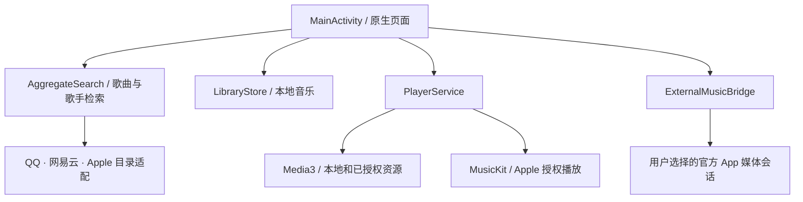

# 开发结构

Record Room 是 Android 原生 Java 应用。页面由 Android View/Canvas 绘制，内部音频由 Media3 或官方 MusicKit 播放；官方 App 联动走 Android MediaSession。主页截图不是网页套壳。

## 代码入口

| 模块 | 入口 | 负责什么 |
| --- | --- | --- |
| 导航与生命周期 | `MainActivity.java` | 页面恢复、前后台监听、显示尺寸变化 |
| 唱机 | `TurntableView.java` | 唱针、唱片、封面替换、拖针与动画 |
| 视觉主题 | `AlbumPalette.java`、`ThemeStore.java`、`DesignSystem.java` | 封面取色、外观偏好与跨页面色彩 |
| 统一搜索 | `AggregateSearch.java`、`AggregateSearchPage.java` | 独立歌曲/歌手请求、分页、重试与迟到结果隔离 |
| 音乐人 | `ArtistPage.java`、`ArtistLibraryData.java` | 三章结构、真实目录身份与专辑加载 |
| 专辑陈列 | `AlbumStackView.java` | 竖放封套、循环选择、展开与抽盘 |
| 账户与目录 | `MusicProvider.java`、各平台 `Provider` | 元数据、账户能力、完整目录与播放资源 |
| 内置播放 | `PlayerService.java` | 播放队列、状态、媒体通知、完整时长校验 |
| 外部联动 | `ExternalMusicBridge.java` | 官方 App 会话选择、元数据和可用控制 |
| 凭据 | `SecureSessionStore.java`、各平台 `SessionStore` | 加密保存、退出与会话代次 |

Java 源码目录：[`app/src/main/java/com/recordroom/vinyl`](../app/src/main/java/com/recordroom/vinyl)。

## 修改时保持的约束

- 歌手 ID 只在所属平台内有意义；同名不是跨平台身份映射。主页筛选不能用姓名覆盖已知的不同 ID。
- 歌曲搜索与歌手搜索分别处理分页/失败；一个平台失败不清空其他平台已成功的结果。
- 本地一首文件不能推断成一整张未导入专辑。在线专辑使用平台完整目录，实际数量以返回结果为准。
- 展开封套不等于开始播放；“查看曲目”和“播放专辑”是不同动作，动画不阻塞二者。
- 播放器归服务管理，布局重建不能创建另一音频实例。隐藏界面停止订阅与绘制，不能停止后台音频。
- QQ 缺失地址、网络失败、试听和会员要求分别处理；不能把所有失败都写成“没有 VIP”。
- 汽水仅保留官方 App 联动入口。旧直连实现的类仍作为历史兼容源码存在，Manifest 不注册其授权页，公开快照不包含其停用网页运行时。

## 构建和检查

[构建步骤](BUILDING.md) · [验证范围](VERIFICATION.md) · [贡献说明](../CONTRIBUTING.md)。

这是手动 Android 构建工程，目前不是 Gradle/Android Studio 一键项目。请使用仓库脚本和固定依赖清单，不要把缓存目录当依赖来源。
